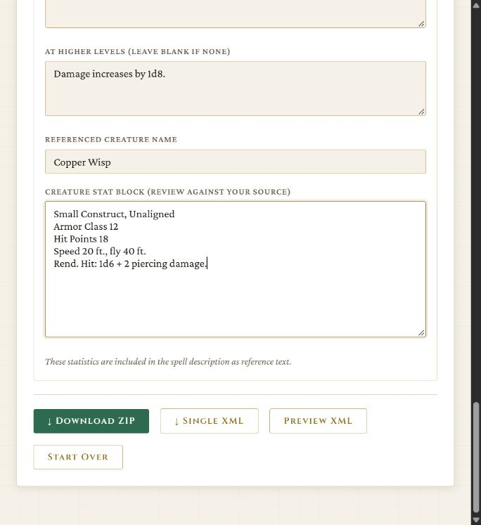

# Focused PDF accuracy check — November 14, 2026

Reviewed the seven-spell section on PDF pages **21–23** (printed pages 19–21)
of the user's local Fizban source, with PDF page **24** read only as continuation
context. The source PDF and first-party XML were read without modification.

The initial structural benchmark already matched all seven spells. Visual
comparison with the PDF exposed defects that its structural comparison did not
measure: OCR dice beginning with `l`, broken words at line endings, an omitted
first die-result label, and missing creature statistics referenced by a spell.

## Changes

- Normalize unambiguous dice OCR errors and observed split words in spell prose,
  upcasting text, and recovered statistics. Preserve unfamiliar hyphenated words
  and genuine compounds instead of removing their hyphens.
- Recover a missing first result label only when a die-result table contains
  every subsequent numbered result exactly once and in order.
- Preserve a named creature stat block that precedes the continued spell prose
  in the same column. Its name and text are editable in review and included as
  escaped reference text in the spell XML. A missing named block raises a
  validation warning. This does not create a companion or automate its actions.
- Prefer definition headings over earlier spell-list entries in source reports.
- Add required mechanics-text checks to the source gate, plus diagnostics for
  ambiguous dice and missing named creature statistics.

## Results

| Check | Result |
| --- | --- |
| Expected spells | 7 of 7, with no extra spells |
| Canonical XML structure | 7 of 7 matches; no differing or unmatched spells |
| Generated XML shape validator | Pass; zero errors or warnings |
| Source accuracy gate | Pass; zero errors, warnings, or review findings |
| Continued descriptions and upcasting | Retained across the selected pages and continuation page |
| Roll-result table | All four labels and their effects retained |
| Referenced creature | Statistics and actions retained as editable reference text |
| Automated regression suite | 145 tests passed in 13 files |
| In-app browser review | Corrected prose, missing-block warning, editable statistics, XML preview, and recovery after refresh passed |

The browser upload automation did not return a file chooser, so its UI check used
the pasted-text workflow with synthetic content. Real PDF extraction was tested
directly against the local book; a generated two-page PDF regression checks the
same column and continuation behavior in CI. No external Chrome session or
desktop capture was used.

## Reproduce

The reusable expectations are in
[`tests/fixtures/fizban-spells.expect.json`](../../../tests/fixtures/fizban-spells.expect.json).
The command in the [fixture guide](../../../tests/fixtures/README.md) runs the
strict source gate against the local PDF. The source book is not committed.

The new synthetic regressions are in
[`tests/pdf-spell-accuracy.test.js`](../../../tests/pdf-spell-accuracy.test.js)
and [`tests/source-validation.test.js`](../../../tests/source-validation.test.js).

The temporary preview server and test tab were closed. Disposable rendered book
pages, extracted text, generated XML, and inspection scripts were removed after
verification. The original source files were left untouched.
