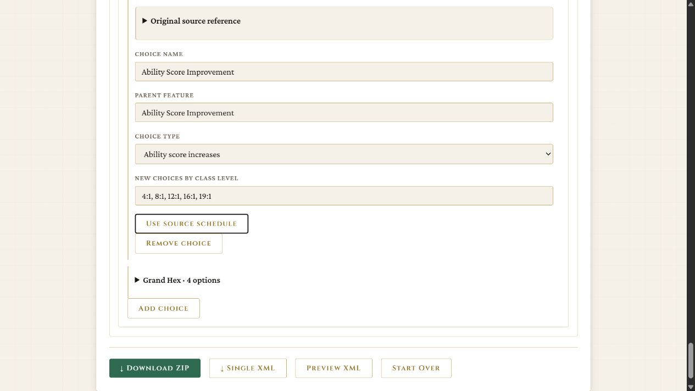

# Class progression and choices

Implemented on codex/class-progression-choices. Source books remain in the
private library; no book prose, extracted caches, or generated book XML is
committed.

## Changes

- A base feature is granted once, at its first progression level. Repeated
  choices have independent schedules. Explicit features absent from the table
  are retained with a review warning.
- Progression differences preserve spell-slot levels, spell and cantrip counts,
  prepared counts, hex counts, and plan counts. Duplicate levels are excluded
  from table-derived gains. Decreases cannot inflate later gains.
- Table cells use strict numbers. Unreadable cells, incomplete levels, unknown
  columns, and unsupported choices produce actionable findings.
- Source option elements and class-scoped pickers cover fighting styles, favored
  enemies, languages, curses, hexes, grand hexes, and Artificer plans. Feature and
  level prerequisites are retained; unresolved prerequisites withhold an option.
- Repeated 2014 ability increases, optional feat alternatives, and 2024 feat
  choices retain their source schedules. No proficiency-bonus stat is added.
- Recognized choice cantrips use an existing or exported spell ID. A homebrew
  spell never receives an invented Player's Handbook ID. Bonus spell choices
  stay inside their owning option.
- Review includes a progression editor, option importer, editable schedules and
  prerequisites. Edits survive draft recovery and preserve new source references
  when applying remembered corrections. Actions keep the relevant editor open.

## Existing-source checks

Physical PDF pages include covers and front matter.

| Source and scope | Result |
| --- | --- |
| UA_RevisedRanger.pdf, pages 2–5 | 20 levels, 13 features; 4 fighting styles; 5 favored and 7 greater favored enemy types; language picks at 1 and 6; ability increases at 4, 8, 12, 16, 19 |
| Complete Witch.pdf, pages 4–8, with option catalogue context | 20 levels, 11 base features; 11 curses, 26 hexes, 10 grand hexes; hex gains 2/1/1/1/1/1 at 1/2/5/9/13/17; grand hex picks at 11/13/15/18; Familiar prerequisites retained |
| Eberron_Forge_of_the_Artificer_OCR.pdf, pages 10–19 | 13 base features; 56 plan entries found; 13 damaged names withheld; unreadable progression explicitly flagged and no plan picker invented |
| Eberron_ Forge of the Artificer.md, readable companion source | 20 levels; 56 plans across tiers 2/6/10/14; 4 initial plans at 2 and one more at 6/10/14/18; improvements at 4/8/12/16 and boon choice at 19 |
| Artificer PDF repaired through the editor handlers using the companion source | 20 levels and 56 readable plans restored, with pasted-source references, correct schedules, and no withheld plan names |

All five generated XML samples pass the PowerShell Aurora shape validator.
The six existing complex-PDF source gates also pass with zero errors, warnings,
or review findings in their established coverage checks.

Run the private-source checks with:

    node scripts/audit-class-progression.js
    node scripts/run-node20.js scripts/run-local-corpus-benchmarks.js --manifest tests/fixtures/complex-pdf-audits.json

The first command accepts an alternate library directory as its first argument.
It asserts source counts, schedules, prerequisites, known spell IDs, incomplete
OCR handling, the repair path, and XML shape. Temporary exports are removed.

## Regression and browser verification

npm test: **231 tests across 19 files**. The 26 new class tests include original
text, a generated three-page PDF with catalogues outside the selected range,
source boundaries and table-of-contents entries, malformed table values,
duplicate and decreasing counts, repeated improvements, minimum levels,
unresolved prerequisites, conditional spell grants, tiered plans, editor
round-trips, draft recovery, remembered corrections, and XML validation.

The in-app browser verified pasted class parsing, navigation from findings,
schedule edits and resets, progression repair feedback, recovered edits after
reload, and XML preview. The synthetic editor screenshot contains no book prose.
No Chrome or desktop screen-capture helper was used.

## Remaining limits

- Artificer PDF numeric OCR is too damaged to establish a reliable table.
  Correction from a readable source is required; this pass does not guess the
  missing values. Its unreadable item names also require correction.
- The Witch table lists Ability Score Improvement without a captured standalone
  description. The app requests the missing description rather than inventing a
  rule. Special familiar forms and their statistics remain manual.
- Activated abilities, situational bonuses, and cross-class duplicate fighting
  styles still need source review. Only exact recognized mechanics are emitted.
- Hex and plan replacement use the recorded source instructions and editing an
  existing Aurora choice. Extra replacement picks are not generated.
- Plan selections track learned plans; they do not create, equip, or remove magic
  items. Subclass and spell dependencies require compatible installed definitions.
- Unrecognized progression resources are preserved and flagged without generated
  mechanics. Full character behavior was not retested inside the Aurora desktop
  app during this milestone.
