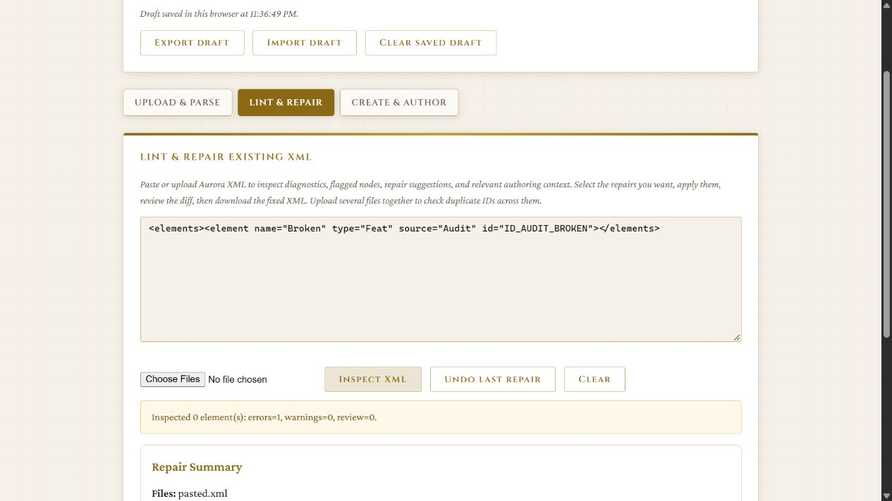
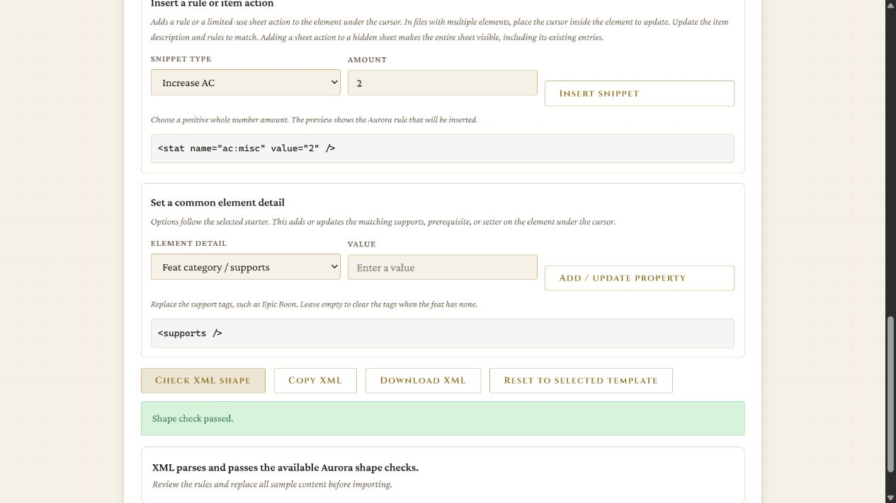

# Feature, workflow, and code review — November 14, 2026

Reviewed the implemented parsing, generation, review, authoring, repair, recovery,
and release-checking features. Fixed problems found in the implementation and
added regression coverage. Browser checks used only the in-app browser and a
temporary local preview. These changes have not been published.

## What changed

### Keeping work safe

- PDF parsing now commits a completed result together with its source details.
  Failure, cancellation, an empty result, or an interrupted import keeps the
  previous entries, baseline, skipped records, and source evidence together.
- Selecting a replacement PDF does not relabel existing results. Source fields
  typed before selection or edited before parsing are respected.
- Parsing releases its PDF loading task and document on completion or cancellation.
  Upload and extraction controls cannot race an active parse.
- Destructive actions use one accessible in-page confirmation dialog. Cancelling
  replacement, reset, import, or export leaves the current work intact.
- Draft imports validate nested editor data before replacement, restore the prior
  workspace on failure, and prevent older asynchronous imports from winning a race.
  Storage failures and conflicts have explicit recovery messages.

### Review, editing, and export

- Removing an element, feature, benefit, trait, choice, or option offers one-level
  undo in the open workspace. Undo restores the matching baseline and refuses to
  act on a replacement workspace.
- Card headings and badges update as fields change. Editor labels are associated
  with their controls, the upload control supports the keyboard, custom subclass
  supports can be entered, and narrow screens use a single column of fields.
- XML preview keeps the pending-edit indicator. ZIP export captures a consistent
  snapshot, prevents overlapping exports, reports failures, and preserves the
  pending indicator if another edit occurs while the archive is being made.
- Empty exports are blocked. ZIPs include `unresolved-items.txt`; Single XML
  includes the same review information in an escaped XML comment. Downloaded
  content therefore carries its known caveats with it.
- Copying several repaired documents no longer produces concatenated, invalid
  XML; the interface directs the user to download the separate files as a ZIP.
- Remembered corrections load correctly after refresh, validate their record and
  field shapes, and report storage failures honestly. New scalar corrections
  replace only edited fields, preserving fresh unedited content and references.
  Older whole-entry corrections and nested collection replacements raise a
  source-review warning.

### Parsing and Aurora rules

- Spell class metadata no longer leaks into descriptions or wrapped casting-time
  text. Conditional tables keep unreadable or invalid levels visible for review.
- Spell grants resolve actual bundled or exported definitions. Compound spell
  names and lists joined by “and” are handled without fabricating unknown IDs.
  Expanded subclass lists extend the relevant casting feature; always-prepared
  rules require suitable evidence. Table spell levels are not used as class levels.
- Feats recognize “have proficiency,” multiple fixed skill grants, multiple
  effects within one benefit, and supported named cantrips. A cantrip grant still
  warns that it does not create a casting feature or choose its ability.
- Generic rules avoid promoting negated, temporary, activated, optional, or
  other-creature benefits into permanent character bonuses. Standard Extra Attack
  timing remains supported. Conditional and unfamiliar mechanics stay in the
  description and receive actionable review findings.
- Restricted language choices retain their actual options and restrictions.
  Unknown capacity is distinguished from the cost of spending magic-item charges.
- Class schedules use bounded acquisition-level evidence. Invalid feature levels,
  table disagreements, unusual ability improvements, and foreign-class option
  prerequisites remain unresolved. Valid modeled ability improvements avoid the
  redundant generic choice warning.
- Removed the empty Steel Defender companion picker: its referenced companion
  definition was never generated. The feature remains visible with a warning to
  supply its companion data separately.

### XML authoring, repairs, and maintainability

- Shared XML scanning respects comments, CDATA, processing instructions, quoted
  `>` characters, direct-child boundaries, and cursor positions between elements.
  Snippet insertion no longer mistakes reference text for editable XML structure.
- Repair and authoring checks share parser-error detection for Firefox and
  Chromium/WebKit error documents. Malformed XML cannot report a successful
  zero-element inspection. Index documents receive appropriate shape checks.
- Empty or self-closing setters are repaired in place without duplicate blocks;
  ambiguous fuzzy renames are withheld. Literal dollar signs survive replacement.
  Valid unrestricted pickers no longer acquire invented support tags.
- XML uploads preserve the existing workspace on duplicate names, read failures,
  empty input, or stale asynchronous completion. Optional Feat supports and display
  prerequisites can be cleared without changing dynamic requirements.
- Removed obsolete model-request implementations and their unreachable extraction
  path. Consolidated duplicate nested editors, confirmation handling, XML range
  handling, and download cleanup. Added cleanup to tests that leaked temporary
  directories. Zero values and valid Unicode survive XML escaping.
- Release checks reject empty manifests and invalid timing settings, and bound
  each request by the remaining overall deadline. CI browser checks now understand
  the in-page confirmations and check exported review information.

## Verification

| Area | Coverage and outcome |
| --- | --- |
| Automated suite | **338 tests passed across 26 files**. Includes parser/golden, source review, spell access, class progression, XML shape/repair/authoring, draft races, extraction cancellation, editing/undo, exports, and release checks. |
| Existing PDF source gates | All six established cases passed: Elemental Evil spells, Marvelous Magic items, Revised Ranger section/full class, and Complete Witch section/full class. Each source gate reported zero errors, warnings, or review findings under its existing expectations. These gates do not compare every mechanic with canonical XML. |
| Private class audit | Ranger and Witch retained 20 progression rows and expected features/options. Damaged Artificer OCR remained incomplete and flagged. The readable companion source retained 20 levels and 56 plans; repairing the PDF-derived record produced shape-valid XML. All five generated XML documents passed the shape check. |
| In-app browser | Uploaded synthetic PDF with spell/feat; source references; edited level zero; remembered correction and reload; cancelled and failed replacement PDF preserving work; malformed repair rejection; selected hit-die repair, diff, and undo; authoring snippet insertion and shape checks; cancelled template/reset; optional Feat support clearing; pasted class with choices; remove/undo; Start Over and draft cleanup. |
| Export verification | Regression tests check archive/XML content, review reports, cancellation, concurrent changes, and failures. A browser download wait stalled; completion of the actual download was not confirmed there. |
| CI/browser scripts | Syntax checked and updated; the external browser smoke job was not run locally. GitHub Actions and the deployed site still require verification after a merge/push. |

## Concerns still requiring work

1. **Rules coverage remains partial.** Activated abilities, temporary bonuses,
   resources, companion statistics, and unfamiliar choices can require manual
   Aurora implementation. Warnings now expose more of these cases; a clean shape
   check is not a guarantee of correct character behavior. The Aurora desktop app
   was not retested in this review.
2. **Damaged sources need a readable reference.** The Artificer PDF still cannot
   establish a trustworthy numeric progression table by itself. The Witch source
   also needs its missing standalone improvement description and special familiar
   data. The app preserves these gaps instead of guessing.
3. **Nested remembered corrections replace collections.** Changing one feature
   can save the whole feature array. Reapplying it can replace new siblings or
   improved unedited descriptions. A persistent review warning now identifies the
   affected collection. Granular corrections matched by feature/option identity
   would be the next improvement to this feature.
4. **Recovery is browser-local.** Large drafts can exceed browser storage and
   separate devices do not share autosave. Exported drafts remain the portable
   backup. No cloud synchronization was introduced.
5. **The main application file is still large.** Obsolete paths and duplicated
   helpers were removed, but splitting extraction transactions, review editors,
   export, and authoring into modules would make later changes easier to maintain.
   Large PDFs also still need a broad text scan for availability context; a worker
   and targeted performance measurements would help assess this cost.
6. **Deployment verification is pending publication.** The changes are local.
   Run the updated automated browser and release checks after merging, then use a
   small Aurora character sample to verify mechanics across levels.

Temporary test PDFs, outputs, and the preview server were removed/stopped after
checking. Test corrections and saved drafts on the isolated preview address were
cleared, and the test tab was closed. Original books and unrelated workspace files
were preserved.
