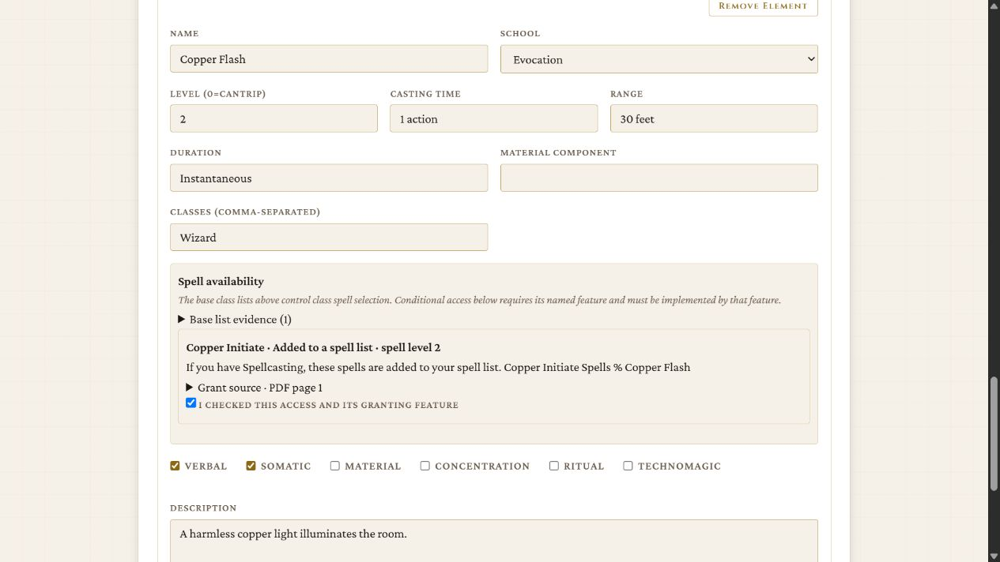

# Spell availability

This pass fills base spell-list memberships from the current source and records
conditional access from subclasses, feats, backgrounds, races, and named features.
It does not broaden the selected definition range or infer availability from
incidental mentions in a spell description.

## Behavior

- Read class-list and grant evidence throughout the current PDF. Keep physical
  page numbers, extracted lines, short excerpts, and the additional pages used.
- Handle separate class lists, lists continued across columns/pages, custom
  classes established by their class section, explicit definition metadata,
  Markdown catalogues, and the split Fizban catalogue.
- Keep conditional routes separate from base classes. Preserve their named owner,
  grant conditions, eligible class choices, and character/class or spell-table
  levels. Expanded lists, known spells, prepared spells, and casting grants have
  distinct labels.
- Recover tables split into reference columns, wrapped spell names, cantrip rows,
  small capital headings, and wrapped background names. Discard URL/page footers
  as possible owners. Preserve source OCR spelling when it cannot be normalized
  safely.
- Leave unreadable levels unresolved and provide an editor to enter the source
  value. Keep contradictory class metadata visible for review.
- Preserve references, corrections, and acknowledgements in drafts. New extractions
  require a fresh review. Remembered level corrections match the same owner and
  condition and keep the current source location.
- Carry base class memberships into Aurora supports. Include conditional access
  as reference text; its owning feature still controls the actual grant, extension,
  or spell choice. A review checkbox does not generate that feature's rules.

Both the app and command-line source/benchmark paths use the same resolver. Source
reports now retain class membership and compare required class lists as sets,
catching both omissions and unwanted extra classes. PDF readers release their
document resources after extraction.

## Existing PDF checks

All pages below are physical PDF pages. Original books stayed in the local
library. No PDFs or extracted book text were committed.

| Source and selection | Result |
| --- | --- |
| Elemental Evil Player's Companion, 15–16 | Nine spells, all base memberships recovered from list pages 12–14. Zero unresolved findings. The fixture now asserts every spell's complete class set. |
| Elemental Evil Player's Companion, 15–25 | Forty-three spell definitions with base lists. Shape Water additionally retains the Water Genasi grant from page 10; that conditional route requires review. Its cantrip grant is not incorrectly delayed to the level of the following racial spell. |
| Complete Witch, 30–36 | Twenty-nine spells assigned to the Witch list on page 29. Hollowing Curse and Ruby-Eye Curse also retain Blood Magic bonus-table references on page 13, with spell levels 1 and 3. These two conditional entries remain for review rather than being treated as automatic preparation or class-wide access. |
| Fizban's Treasury of Dragons, 21–23 | Seven spells retain the complete class sets from the catalogue, including Artificer and Ranger where specified. Zero unresolved findings. All seven membership sets are now strict fixture expectations. |
| Guildmasters' Guide to Ravnica, reference-only availability checks | Chaos Bolt and wrapped Unseen Servant retain Izzet Engineer access on page 67; Encode Thoughts retains Dimir Operative access on page 47 at spell level 0; Counterspell retains Azorius Functionary access on page 35 at spell level 3. These are background list expansions. They do not create spell definitions or base class memberships. Some owner names preserve the PDF's OCR spacing. |
| Eberron: Forge of the Artificer OCR PDF, reference-only availability checks | Detect Magic and See Invisibility retain Mark of Detection prepared access on page 47, including character level 3 for See Invisibility. Identify and Detect Thoughts retain the feat's expanded-list routes. The unreadable OCR level on the Detect Thoughts row stays unresolved; the resolver does not invent its value. |
| Fizban's Treasury of Dragons, feat reference-only check | Cure Wounds retains Gift of the Metallic Dragon as a known-spell route from page 19, including usage and spellcasting-ability text. It does not add any base class support. |

The six existing complex-PDF source gates and the focused Fizban gate pass. The
two spell gates now require complete membership sets. Four independently generated
spell exports pass the PowerShell shape validator with zero errors or warnings.
Overlapping PDF selections are validated independently, not installed together.

## Browser and regression checks

Used the in-app browser only:

- Parsed the actual nine-spell PDF selection. Absorb Elements shows Druid,
  Ranger, and Wizard evidence on pages 12 and 14 while its definition stays on
  page 15. Additional availability pages are disclosed separately.
- Parsed the actual Shape Water section. Reviewed the Water Genasi route,
  confirmed that XML supports remain Druid, Sorcerer, and Wizard, and verified
  that the conditional route does not produce an unconditional grant. Reloading
  preserved the references and review acknowledgement.
- Parsed an original synthetic three-page PDF with the definition on page 2,
  availability on page 1, and a different spell outside the selection. Followed
  an unreadable-level warning to its input, entered the source value, and reviewed
  the grant. Reloading recovered the correction and acknowledgement.
- Downloaded the synthetic ZIP and checked its two XML files with the PowerShell
  validator. They contain the base support and conditional reference, with no
  outside spell. Final XML preview also confirms that the Spellcasting condition
  and corrected spell level are retained.

The full suite passes: **205 tests in 18 files**. Twenty-six new regressions cover
source boundaries, class membership, conditional owners, choices, table layouts,
unreadable levels, complete grant conditions, safe XML, draft recovery, and
remembered-correction provenance. The browser release scenario now checks a class
list and feat grant outside the selected range before recovery and ZIP export;
that updated automated browser scenario will run after these changes are pushed.

## Remaining scope

This is source-based availability for the current export, not a database of every
book and edition. Unknown layouts and conditional grants expressed through more
complex rules still require comparison with the source. Reference-only audits do
not claim to extract full spell definitions from those sections. Checking a route
acknowledges human review; it does not certify its owning feature's automation.

Class progression and choices remain the next milestone, including the owning
feature rules needed for conditional spells to appear at the correct levels and
under the correct selections in Aurora.
